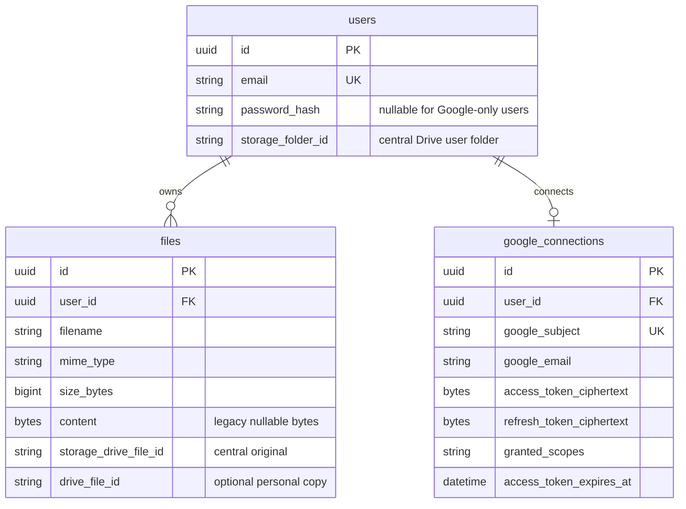

# API and data model reference

This reference describes the routes and schema in the current PoC. All API routes below have the `/api/v1` prefix. The [concept guide](concepts.md) explains why the pieces exist; the [flow diagrams](study.md) show their order.

## Data model



`users.id` is the File Vault identity. `google_subject` is the stable Google identity used for sign-in and linking; email is not used to merge identities. `files.id` is the ID accepted by app file routes. `storage_drive_file_id` identifies the original in the unregistered storage account. `drive_file_id` identifies the optional copy in a user's personal Drive. The browser receives `files.id` and possibly `drive_file_id`, but never `storage_drive_file_id` or the central token. See [`models.py`](../backend/app/models.py) and [`file_json()`](../backend/app/files.py).

New uploads set `files.content` to `NULL`. `stored_bytes()` still reads that column for historical rows without a central Drive ID. Schema changes are managed by Alembic; [`9d38c7a10f21`](../backend/alembic/versions/9d38c7a10f21_central_drive_storage.py) added central references and made legacy bytes nullable. Its downgrade refuses to discard files whose bytes are not first restored to PostgreSQL. The old `google_oauth_transactions` table is historical and unused in the current OAuth flow.

## Route map

| Route | Session | Body or query | Result and effect |
| --- | --- | --- | --- |
| `POST /auth/register` | No | JSON `email`, `password` | Creates a password user and sets app JWT cookie. |
| `POST /auth/login` | No | JSON `email`, `password` | Verifies password and sets app JWT cookie. |
| `GET /auth/me` | Yes | None | Current local user ID and email. |
| `POST /auth/logout` | Optional | None | Deletes the app JWT cookie. |
| `GET /google/connect` | Optional | None | Redirects to Google for sign-in or explicit linking. |
| `GET /google/callback` | OAuth state cookie | Google code and state | Verifies identity, saves encrypted user tokens, sets app session, redirects. |
| `GET /google/status` | Yes | None | Connected email and whether Gmail scope is recorded. |
| `POST /google/disconnect` | Yes | None | Clears user Google tokens; keeps subject link. |
| `GET /google/files` | Yes + Drive connection | None | Up to 100 files visible to this app under the user's Drive grant. Learning endpoint; dashboard does not use it. |
| `POST /files` | Yes | Multipart field `file` | Uploads at most 5 MiB to central Drive; writes metadata row. |
| `GET /files` | Yes | `page` ≥ 1; `page_size` 1–50 | Owner-filtered file page, ordered newest first. |
| `GET /files/{id}` | Yes + owner | None | Attachment download of stored bytes. |
| `GET /files/{id}/preview` | Yes + owner | None | JSON text/table, image bytes, or PDF bytes based on file type. |
| `POST /files/{id}/drive` | Yes + owner + Drive connection | None | Copies bytes to that user's Drive once, recording `drive_file_id`. |
| `POST /files/{id}/gmail-draft` | Yes + owner + Gmail scope | JSON `email` | Creates an unsent Gmail draft with the file attached. |
| `GET /health` | No | None | Process health response; does not verify DB or Google availability. |

All protected file routes call the same owner filter. A missing file and another user's file both return 404. Mutating browser routes require the configured `Origin`. The frontend [`api.ts`](../frontend/lib/api.ts) sends cookies and disables fetch caching. Do not use `/google/files` as a replacement for the app-owned file list: it reports what the *Google grant* can see, while `/files` reports what the *local user* owns.

## Request and response examples

The browser sends the JWT cookie automatically. These examples show shapes, not real credentials or IDs.

### List files

```http
GET /api/v1/files?page=2&page_size=10
Cookie: filevault_auth=<app-jwt>
```

```json
{
  "items": [{
    "id": "aaaaaaaa-aaaa-aaaa-aaaa-aaaaaaaaaaaa",
    "filename": "notes.pdf",
    "mime_type": "application/pdf",
    "size_bytes": 24890,
    "drive_file_id": null,
    "created_at": "2026-10-25T10:00:00+00:00"
  }],
  "total": 11,
  "page": 2,
  "page_size": 10
}
```

`drive_file_id: null` means no recorded personal Drive copy. It says nothing about whether the original exists in central storage; central storage IDs are not returned here.

### Copy to the connected user's Drive

```http
POST /api/v1/files/aaaaaaaa-aaaa-aaaa-aaaa-aaaaaaaaaaaa/drive
Cookie: filevault_auth=<app-jwt>
Origin: http://localhost:3000
```

```json
{ "drive_file_id": "personal-google-file-id", "uploaded": true }
```

On repeat, `uploaded` becomes `false` and the recorded ID is reused. This endpoint creates a copy; it does not call Drive `permissions.create`.

### Create a Gmail draft

```http
POST /api/v1/files/aaaaaaaa-aaaa-aaaa-aaaa-aaaaaaaaaaaa/gmail-draft
Content-Type: application/json
Cookie: filevault_auth=<app-jwt>
Origin: http://localhost:3000

{ "email": "recipient@example.com" }
```

```json
{ "draft_id": "gmail-draft-id", "recipient": "recipient@example.com" }
```

The browser opens Gmail Drafts after success. The user sends the message there. Any valid email address is accepted; `gmail.com` is not required.

### Preview

For text or Markdown, the endpoint returns JSON such as `{"kind":"text","text":"hello","truncated":false}`. CSV uses `{"kind":"table","rows":[["name"],["Alice"]],"truncated":false}`. Images return a validated `image/*` response. PDF and converted Office documents return `application/pdf`. The client reads binary responses into private blob URLs and revokes them when the preview closes.

## Error classes to recognize

| HTTP status | Typical cause | What to inspect |
| --- | --- | --- |
| 400 / 422 | Bad upload, input, email, or page parameter | Request shape and limits. |
| 401 | No valid app session, or an expired Google grant on a Google action | Distinguish `/auth/me` from the action that failed; reconnect Google only for Google grant failures. |
| 403 | Invalid write `Origin`, disabled Google API, missing Google permission, or Workspace policy | Response `detail`, OAuth consent, Cloud API enablement. |
| 404 | File ID absent or owned by another user | Current local user and file ID. |
| 409 | Account conflict or required Google connection/scope absent | Linked Google account and requested scope. |
| 413 / 415 | Preview too large or unsupported/invalid format | File size and actual bytes. |
| 502 / 503 | Google/storage/converter failure or missing configuration | Backend logs, storage grant, converter process, Google response. |

Errors are not all retryable. In particular, an upload, Drive copy, or Gmail draft may have succeeded externally even if the response was lost. Check the destination before retrying to avoid duplicates.

## Configuration and local services

| Setting | Role |
| --- | --- |
| `JWT_SECRET_KEY` | Signs and verifies app session JWTs. |
| `GOOGLE_TOKEN_ENCRYPTION_KEY` | Fernet key for user tokens, central token, and OAuth state cookies. Preserve it across restarts. |
| `GOOGLE_CLIENT_ID`, `GOOGLE_CLIENT_SECRET`, `GOOGLE_REDIRECT_URI` | Google OAuth client and callback. |
| `FRONTEND_ORIGIN` | Allowed credentialed browser origin and expected write origin. |
| `DB_*` | PostgreSQL connection. |
| `STORAGE_GOOGLE_*` | Separate storage account email, root folder ID, and encrypted refresh token. |
| `PREVIEW_CONVERTER_URL` | Backend URL for Office-to-PDF conversion; defaults to `http://127.0.0.1:3001`. |
| `NEXT_PUBLIC_API_BASE_URL` | Browser-visible FastAPI base URL; defaults to `http://localhost:8000`. |

The Compose stack starts PostgreSQL on local port 5432 and Gotenberg on local port 3001. FastAPI and Next.js run on the host in the documented local setup. Both frontend and backend URLs must use `localhost` for the host-only cookie to be shared across ports. The converter is needed only for DOCX/XLSX/PPTX preview; other file actions do not depend on it. See the [setup guide](../README.md) and [storage setup](storage-setup.md).
