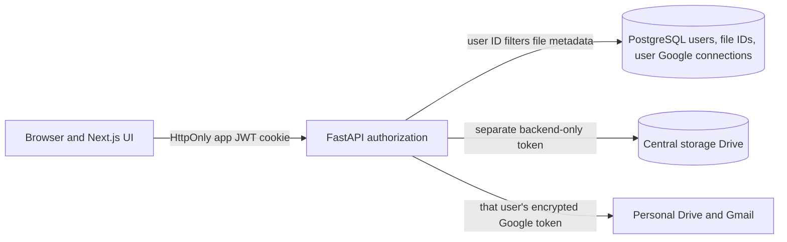
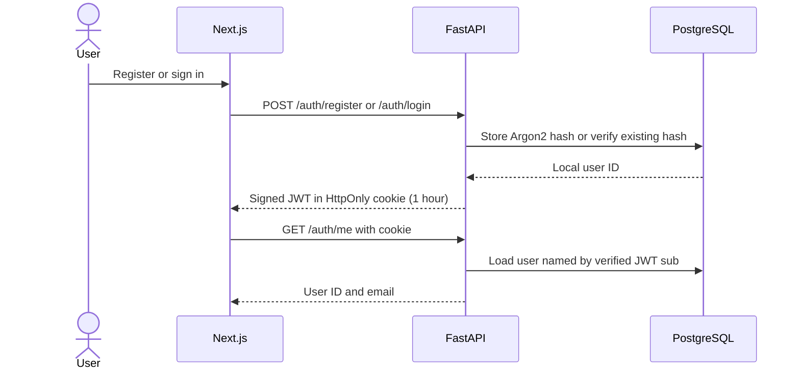
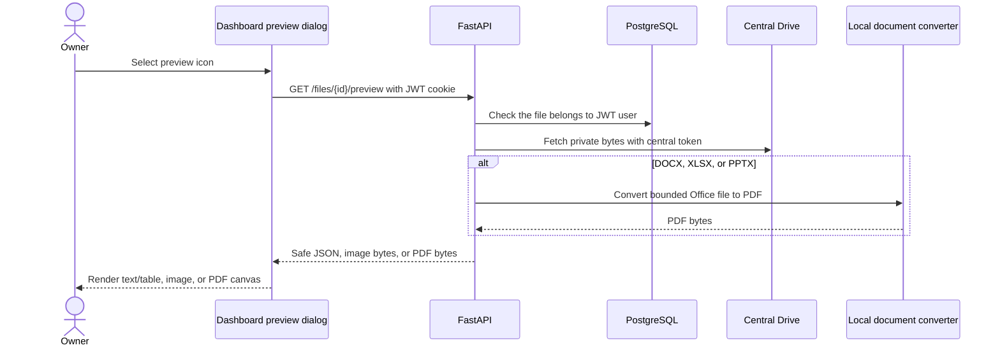

# Security architecture and study guide

File Vault has **three relevant permissions**. The app's JWT says which local user may use the dashboard and which PostgreSQL file records belong to them. A separate, unregistered Google account grants the backend access to central Drive storage. A user's own Google OAuth grant allows personal Drive copies and Gmail drafts. Creating a draft does not send mail or grant a recipient access to a Drive file.

Read [concepts](concepts.md) for the terms behind these diagrams, [API and data](api-and-data.md) for exact routes and IDs, and the [decision guide](decision-guide.md) before treating the PoC as a deployment design.

## Trust boundaries



The frontend may show a connected state or a list of file IDs, but those values are **not authorization**. FastAPI verifies the JWT signature and expiry, loads the user from PostgreSQL, and selects files by both file ID and `user_id` before reading central Drive. The browser never receives the central storage token or the root folder ID. Google independently decides whether each token can access its corresponding account.

## Password sign-in



The password is never stored directly. [`auth.py`](../backend/app/auth.py) hashes it with Argon2 and issues a signed HS256 JWT containing the local user UUID, issuer, issue time, and expiry. The JWT is **signed, not encrypted**; it contains no password or Google token. The backend sets it in an HttpOnly, SameSite=Lax cookie. HTTPS deployments also mark it Secure. The browser sends it automatically, while JavaScript cannot read it.

[`dashboard/page.tsx`](../frontend/app/dashboard/page.tsx) checks the cookie with `GET /auth/me` before rendering the dashboard. Every backend file and Google route repeats the authorization check. Protecting the page alone would not protect the data APIs.

## Google sign-in and account linking

```mermaid
sequenceDiagram
    actor User
    participant Browser
    participant API as FastAPI
    participant Google as Google OAuth
    participant DB as PostgreSQL
    User->>Browser: Continue with Google or Connect Drive
    Browser->>API: GET /google/connect
    API-->>Browser: Encrypted state, PKCE verifier, nonce cookie
    Browser->>Google: Request openid, email, drive.file, gmail.compose consent
    Google-->>API: Callback with code and state
    API->>API: Verify state and PKCE, exchange code
    API->>Google: Validate signed ID token against Google keys
    API->>API: Check issuer, audience, expiry, nonce, verified email
    API->>DB: Find stable Google sub or explicitly link local user
    API->>DB: Encrypt and save Google access and refresh tokens
    API-->>Browser: App JWT cookie; redirect to dashboard
```

The authorization request uses a 10-minute encrypted browser cookie for **state**, the original **PKCE verifier**, and an OpenID Connect **nonce**. State ties the callback to the browser that started it; PKCE ties the code to the original request; nonce ties the signed ID token to this flow. [`google.py`](../backend/app/google.py) verifies Google's ID-token signature using Google's public keys and checks audience, issuer, expiry, nonce, and `email_verified` before using its identity claims. The stable Google `sub` identifies the Google account; email is display information and can change.

There are two linking paths:

- **Already signed in locally:** Connect Google from the dashboard. The encrypted state records the local user ID and the verified Google account is explicitly linked to it. A Google subject already owned by another local user is rejected.
- **No local session:** Continue with Google signs in an already linked subject or creates a Google-only user with no password hash. If the verified email matches an unlinked password account, the flow asks the user to sign in with a password first. It does not silently merge accounts by email.

User Google access and refresh tokens are encrypted with Fernet before storage in `google_connections`. Only FastAPI decrypts them. Before a personal Drive or Gmail call, it refreshes an expiring access token. Existing users must reconnect to grant `gmail.compose`; the backend checks that scope before creating a draft. The central storage account is authorized separately through [`setup_storage.py`](../backend/scripts/setup_storage.py) and has no row in `users` or `google_connections`. Its encrypted refresh token is configured in `backend/.env`. See the [storage setup guide](storage-setup.md).

## Stored files and copying to your Drive

```mermaid
sequenceDiagram
    actor User
    participant UI as Dashboard
    participant API as FastAPI
    participant DB as PostgreSQL
    participant Store as Central Drive
    participant Drive as User Drive
    User->>UI: Upload file
    UI->>API: POST /files with JWT cookie and file
    API->>Store: Upload bytes under app/user ID folders
    Store-->>API: Central Drive file ID
    API->>DB: Save owner and file metadata, not bytes
    User->>UI: Send stored file to my Drive
    UI->>API: POST /files/{id}/drive
    API->>DB: Confirm user owns file; load personal Google token
    alt First copy of this file
        API->>Store: Fetch bytes using central token
        API->>Drive: files.create with user's Google token
        Drive-->>API: Drive file ID
        API->>DB: Save Drive file ID
    end
    API-->>UI: Drive file ID and upload status
```

[`files.py`](../backend/app/files.py) accepts at most 5 MiB per file. New uploads write bytes to the central storage account and keep only `storage_drive_file_id`, owner, name, MIME type, and size in PostgreSQL. A user folder is created on first upload and its ID saved on the user row. Listing, download, personal Drive copying, and Gmail drafts always filter by the authenticated `user_id`. The list endpoint returns `items`, `total`, `page`, and `page_size`; it defaults to 10 files per page and caps requests at 50. The personal Drive route fetches central bytes and uploads a separate copy with the user's token. It stores that copy's `drive_file_id` so another click does not upload it again. No Drive sharing permission or invitation is created.

**Which Google account receives the file?** If you signed in with a password, use **Connect Google Drive** on the dashboard and choose the account you want to receive copies. If you signed in with Google, the account chosen during that consent flow is connected automatically. The backend always selects the `google_connections` row owned by the current local user; the browser cannot supply another Google account ID.

## Creating an attached Gmail draft

```mermaid
sequenceDiagram
    actor Owner
    participant UI as Dashboard
    participant API as FastAPI
    participant DB as PostgreSQL
    participant Store as Central Drive
    participant Gmail
    Owner->>UI: Enter recipient email and choose Create draft
    UI->>API: POST /files/{id}/gmail-draft with JWT and email
    API->>DB: Confirm file belongs to JWT user; load that user's Google token
    API->>Store: Fetch stored bytes with central token
    API->>Gmail: drafts.create with MIME attachment using user's token
    Gmail-->>API: Draft ID
    API-->>UI: Draft ID
    UI-->>Owner: Open Gmail Drafts in new tab; review and send manually
```

The browser supplies a recipient email and file ID. [`files.py`](../backend/app/files.py) verifies the JWT user and file ownership before fetching central bytes, then uses that user's Google token. [`google.py`](../backend/app/google.py) creates a MIME message with those bytes attached and calls Gmail [`drafts.create`](https://developers.google.com/workspace/gmail/api/guides/drafts). It never calls `drafts.send` or Drive `permissions.create`. Google returns a draft ID, but does not document a stable Gmail web URL for that specific draft. The browser opens Drafts in a new tab, where the user selects the new draft. If multiple Google accounts are signed into the browser, the user must select the connected account shown on the dashboard. A retry after an uncertain API failure could create a second draft.

## Previewing a private file



[`preview.py`](../backend/app/preview.py) chooses a renderer from the filename extension, then checks the bytes instead of trusting the MIME type reported during upload. Text, code, and HTML become JSON strings and React text nodes; CSV becomes a bounded table. Markdown renders without raw HTML or external images. Safe raster images use blob URLs. PDFs and converted Office files render on a PDF.js canvas without embedding the document as a web page. The converter runs in a separate Docker service with time and resource limits. Preview responses disable caching and never expose central Drive IDs or public links. Unsupported files return 415. A missing converter affects Office preview only; stored files remain downloadable.

## Database and migration

| Table | Important fields |
| --- | --- |
| `users` | UUID, email, nullable Argon2 password hash, central user-folder ID. |
| `files` | Owner UUID, name, MIME type, size, central Drive file ID, optional personal Drive file ID. The legacy bytes column is nullable. |
| `google_connections` | Owner UUID, unique Google subject, encrypted tokens, granted scopes, expiry. |

The old migration chain is retained so existing databases remain recognizable. `74e6b6b7c1a0` adds personal Drive links; `9d38c7a10f21` makes file bytes nullable and adds central Drive references and user-folder IDs. Run `cd backend && .venv/bin/alembic upgrade head`. Older file rows with PostgreSQL bytes remain readable until the PoC database is cleaned. The older `google_oauth_transactions` table remains in the historical schema but is unused.

## Operational boundaries and tradeoffs

| Area | Current behavior | Next safeguard for wider deployment |
| --- | --- | --- |
| CSRF | State-changing API routes require the configured frontend or backend `Origin`; cookies use SameSite=Lax. | Keep exact HTTPS origins and review reverse-proxy headers. |
| CORS | FastAPI allows credentialed requests only from `FRONTEND_ORIGIN`. | CORS controls browser access; it is not authentication. |
| Cookies | The local JWT is host-only. Local `localhost:3000` and `localhost:8000` share it across ports. | Use one hostname or a same-origin proxy if deploying frontend and API on different hosts. |
| Logout | Deletes the browser's app JWT. | Existing JWTs cannot be revoked before their one-hour expiry without a server-side denylist or session store. |
| Disconnect Google | Clears encrypted Drive tokens, but keeps the Google subject link so that account can sign in again. | Revoke the Google grant separately if full revocation is required. |
| Password accounts | Registration accepts an email without proving ownership. | Add email verification, password reset, and durable login rate limiting before public launch. |
| Drive upload | A successful upload's Drive ID is saved; repeat requests reuse it. | If Google accepts an upload but its response is lost before the ID is saved, a retry could create a duplicate; reconciliation needs a more advanced workflow. |
| Gmail drafts | The backend creates an addressed draft with a file attachment; the user sends it in Gmail. | [`gmail.compose` is a restricted scope](https://developers.google.com/workspace/gmail/api/auth/scopes) and public deployment may need Google verification. A lost API response may lead to duplicate drafts on retry. |
| File storage | New bytes live in the private central Drive; PostgreSQL owns the authorization index. The backend proxies downloads after owner checks. | Protect the central token, monitor its quota and availability, and reconcile orphaned Drive files after failed DB commits. |
| Tests | Backend uses an isolated database and mocked Google; frontend tests the API client and build. | Add a separate sandbox Google integration run and browser UI tests when credentials and CI support them. |

`GET /google/status` checks whether encrypted Google credentials and the Gmail scope are recorded; it does **not** ask Google whether the grant still works. A later Drive or Gmail call can still return 403 for a disabled API, missing scope, or Workspace policy. Read the response's `detail` field.

`GET /google/files` is an optional read route for learning the Drive API. It returns up to 100 files visible under `drive.file`; the dashboard uses the PostgreSQL file list instead. Copying a stored file to the connected account's Drive happens through `POST /files/{id}/drive`.

## Study path

1. Read [`auth.py`](../backend/app/auth.py) and follow a password login through the JWT cookie to `current_user()`.
2. Read [`google.py`](../backend/app/google.py) from `connect()` through `callback()` and compare its state, nonce, and ID-token checks.
3. Read [`files.py`](../backend/app/files.py) and trace where `user_id` is applied before file content, Drive copying, or Gmail draft creation is accessed.
4. Read the [API and data model](api-and-data.md); identify where the central and personal Drive IDs enter and leave each request.
5. Run the [backend tests](../backend/tests/test_flow.py) and [frontend tests](../frontend/tests/api.test.mjs), then follow the setup in the [root README](../README.md).
6. Work through the [decision guide](decision-guide.md) with your own audience, file volume, security requirements, and recovery targets.
